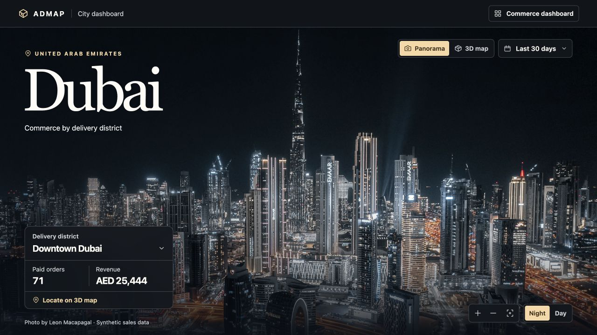
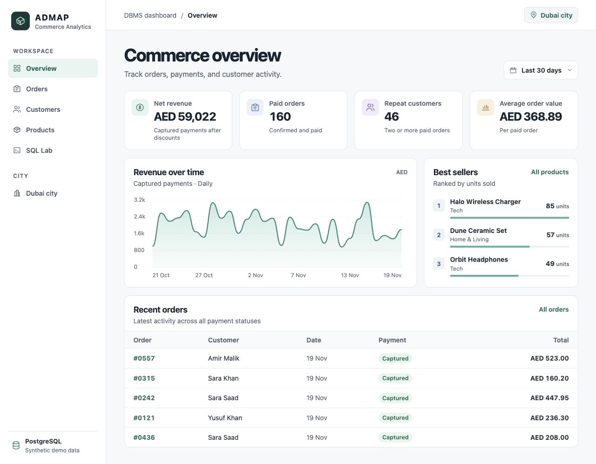
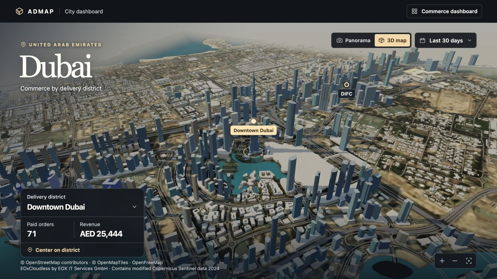
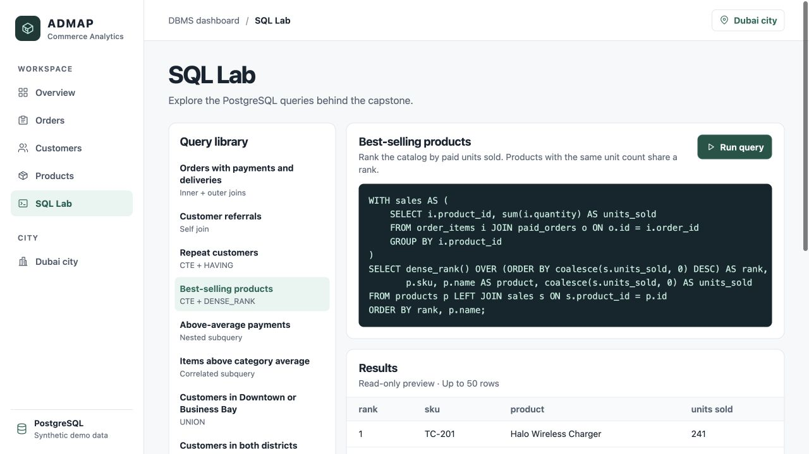
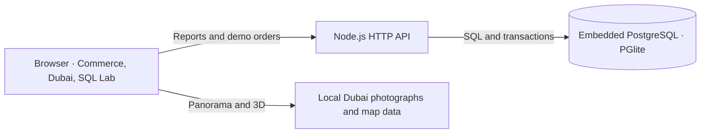

# ADMAP

**E-commerce analytics for a demo store in Dubai** · DBMS Savencia capstone

ADMAP follows an order from checkout through payment and delivery. The commerce dashboard shows sales, repeat customers, product rankings, and inventory. The Dubai dashboard groups paid orders and revenue by delivery district, and SQL Lab lets you run the PostgreSQL queries behind the reports.

[Quick start](#quick-start) · [Application previews](#application-previews) · [Demo walkthrough](#demo-walkthrough) · [Database design](#database-design)



*Dubai City in Panorama mode. Figures come from synthetic demo orders. [Night photograph by Leon Macapagal](https://www.pexels.com/photo/aerial-photography-of-a-modern-city-13398540/).*

## Quick start

Use **Node.js 22 or newer** and npm.

```sh
git clone https://github.com/Aakash9318/DBMS_Savencia.git
cd DBMS_Savencia
npm ci
npm start
```

Open [the commerce dashboard](http://127.0.0.1:3000/). On first launch, the app creates a local PostgreSQL database with **566 synthetic orders**. The database lives in `.data/`, so orders you create survive a restart. PGlite runs PostgreSQL inside the Node.js process.

Use `ADMAP_DATA_DIR=memory:// npm start` for a fresh demo that resets when the server stops. The Dubai **3D map** requires WebGL 2. The bundled panoramas and map assets work without an API key.

## Application previews

### Commerce dashboard



| Dubai 3D map | SQL Lab |
| --- | --- |
| [](docs/previews/dubai-3d-map.jpg) | [](docs/previews/sql-lab.jpg) |
| Orbit central Dubai, zoom into Downtown, or jump to a delivery district. | Read and run ten PostgreSQL reports against the demo database. |

The 3D view combines OpenStreetMap geometry with a satellite basemap. Heights are estimated where the map data omits them. [Photography, geometry, and satellite credits](docs/capstone.md#dubai-imagery-and-map-data)

## Demo walkthrough

1. In **Overview**, change the date range and compare net revenue, paid orders, repeat customers, and average order value.
2. In **Orders**, open an existing order to inspect its line items, discount, payment, and delivery. Select **New order** to create a synthetic purchase. Apply `WELCOME10` or `WEEKEND15` to see how a discount affects the final amount.
3. In **Customers**, filter for repeat buyers. In **Products**, compare best sellers and filter for low stock.
4. In **SQL Lab**, run **Best-selling products** to see how `DENSE_RANK` handles ties, or run **Customers in both districts** to see `INTERSECT` applied to order data.
5. In **Dubai City**, select Downtown Dubai, Business Bay, DIFC, or Dubai Design District. Switch between day and night photographs, then use **Locate on 3D map** to explore the selected district. Drag to orbit, Shift-drag to pan, and use **Show all districts** to return to the city overview.

## Database design



Checkout reserves stock, captures the simulated payment, and queues delivery in one transaction. Order lines retain the price charged at checkout. The dashboard counts an order as paid when the order is confirmed and its payment is captured. The same paid-order view feeds the commerce and city dashboards.

| Coursework | Source |
| --- | --- |
| Ten tables, constraints, three views, and indexes | [Schema](db/schema.sql) |
| Seed inserts and updates | [Seed data](db/seed.sql) |
| Analyst permissions with `GRANT` and `REVOKE` | [Permissions](db/permissions.sql) |
| Transaction boundaries and savepoint rollback | [Transaction example](db/transaction.sql) |
| Joins, subqueries, set operations, CTEs, and window functions | [SQL reports](db/analysis.sql) |
| ER diagram, normalization through BCNF, and metric definitions | [Capstone design notes](docs/capstone.md) |

## Tests

```sh
npm test
```

The suite checks report totals, analyst access, savepoint rollback, checkout consistency, stock contention, and persistence across restarts.
