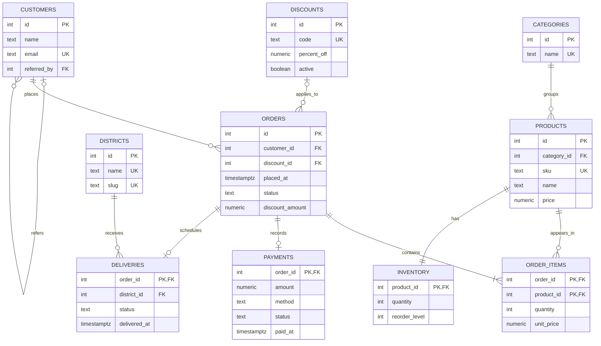

# ADMAP capstone design

## Project scope

The assignment screenshots specify a relational e-commerce database and customer purchasing analysis. This prototype models one store that delivers to four Dubai districts. It records customers, catalog prices, available stock, orders, line items, payments, discounts, and deliveries. It answers which customers return, what products sell best, and where paid orders were delivered.

The raw ADMAP concept centered on advertising campaigns and multiple merchants. The implemented scope carries forward the Dubai visualization and uses the commerce records as its source. District figures are grouped by an order's delivery district. All customer and transaction records are synthetic.

## ER model



The application creates one or more items per order and one inventory row per seeded product. Primary or unique keys enforce the maximum cardinalities. The order transaction and seed enforce the minimums of one item per order and one stock row per catalog product. Each order can have one applied discount, one payment record, and one delivery record. This model assumes captured payments are final, with no refunds or split tenders.

## Normalization walkthrough

| Stage | Change | Dependency |
| --- | --- | --- |
| 1NF | Start with an order form containing a list of products. Flatten it into one row per product per order with atomic fields. | The composite row key is `(order_id, product_id)`. |
| 2NF | Put the order header in `orders` and catalog attributes in `products`. Keep quantity and historical sale price on `order_items`. | `order_id → customer_id, placed_at, status`. `product_id → sku, name, catalog price`. The pair determines quantity and historical unit price. |
| 3NF | Move customer details, category names, discount rules, and delivery district names to their own tables. Store payment and delivery facts in their own optional relations. | `order_id → customer_id → customer name` and `product_id → category_id → category name` disappear from the wider relations. |
| BCNF | Under the demo's business rules, every modeled nontrivial determinant within a table is a candidate key or contains one. | IDs determine the entity attributes. Alternate keys are unique email, SKU, discount code, category name, district name, and district slug. The line key is the pair of IDs. Stock, payment, and delivery use their foreign key as their primary key. |

The catalog price is today's price. `order_items.unit_price` is the price charged when the order was placed. `orders.discount_amount` records the discount applied at checkout. A captured payment amount represents a separate payment fact and is recorded in the same transaction as the discounted order so the figures reconcile. Subtotals and order totals are computed in `order_summary`.

## SQL coverage

| Rubric item | Where to demonstrate it |
| --- | --- |
| Relational schema, constraints, views, indexes, and DDL | [schema.sql](../db/schema.sql) creates ten tables and three views. The indexes support customer history, order dates, referrals, product joins, discount joins, and district lookup. |
| DML | [seed.sql](../db/seed.sql) inserts and updates records. The **New order** flow inserts order, item, payment, and delivery records and updates inventory. |
| DCL | [permissions.sql](../db/permissions.sql) grants the analyst access to approved views and columns. It demonstrates an inventory grant and its revocation. Reports and analytics execute with that role. |
| TCL | [transaction.sql](../db/transaction.sql) demonstrates `BEGIN`, `SAVEPOINT`, `ROLLBACK TO SAVEPOINT`, and `COMMIT`. Checkout commits its related edits together or rolls them back on failure. |
| Inner, outer, and self joins | **Orders with payments and deliveries** preserves orders with missing related records. **Customer referrals** joins the customers table to itself. |
| Nested and correlated subqueries | **Above-average payments** uses the overall mean. **Items above category average** correlates the comparison with the outer product's category. |
| Set operations | **Customers in Downtown or Business Bay**, **Customers in both districts**, and **Customers without a paid order** use `UNION`, `INTERSECT`, and PostgreSQL `EXCEPT`. |
| CTEs and window functions | **Repeat customers** groups purchase history in a CTE. **Best-selling products** uses a sales CTE and `DENSE_RANK`. |
| Testing and validation | [database.test.mjs](../test/database.test.mjs) verifies results, transaction rollback, privilege boundaries, stock contention, and persistence. |

The SQL files use PostgreSQL syntax. To demonstrate the scripts in a separate PostgreSQL database, connect as a role that can create schemas and roles. Run `schema.sql`, `seed.sql`, and `permissions.sql` in that order in a fresh database. Run `analysis.sql` and `transaction.sql` after setting `search_path` to `commerce, public` in the session.

## Analytics definitions

- **Paid order** means an order with confirmed status and a captured payment.
- **Net revenue** is the sum of captured payment amounts for paid orders, after recorded discounts. Average order value divides this sum by the paid-order count.
- **Repeat customer** means a customer with two or more paid orders in the selected period.
- **Best seller** ranks products by units on paid orders. Tied unit counts share a rank.
- Date filters use order placement in Dubai local time. The default view covers the current day and prior 29 days. The SQL Lab reports use all stored records.
- **City totals** use the same paid-order definition, grouped by delivery district. Displayed revenue cards round to the nearest AED. Order details and SQL results retain currency precision.

## Dubai imagery and map data

- **Night panorama** uses Leon Macapagal’s [Dubai night photograph](https://www.pexels.com/photo/aerial-photography-of-a-modern-city-13398540/). **Day panorama** uses Nelemson G’s [Downtown Dubai photograph](https://www.pexels.com/photo/aerial-view-of-dubai-skyline-with-burj-khalifa-29470840/). Both photographs are covered by the [Pexels license](https://www.pexels.com/license/) and bundled locally as resized WebP assets.
- **3D map geometry** uses [OpenStreetMap contributors’ data](https://www.openstreetmap.org/copyright) under the [ODbL 1.0](https://opendatacommons.org/licenses/odbl/1-0/), served by [OpenFreeMap](https://openfreemap.org/) using the [OpenMapTiles schema](https://openmaptiles.org/). The bundled extract contains 13,718 building footprints or building parts, 9,883 road paths, 151 water polygons, and 991 green areas. Locations and recorded heights come from the map data. The renderer estimates a low-rise height where it is missing and adds illustrative lighting, roof colors, and façade shading.
- **Satellite basemap** uses [EOxCloudless](https://cloudless.eox.at/) by EOX IT Services GmbH and contains modified Copernicus Sentinel data 2024. This asset is [CC BY-NC-SA 4.0 for this academic project](https://cloudless.eox.at/license-non-commercial). The original WMS crop uses the `s2cloudless-2024` layer at `55.2381324965,25.167349885,55.3254514090,25.232346499` in longitude/latitude. It was resized and encoded as WebP.

The panorama is a photograph at two fixed viewpoints. The 3D map is an interactive rendering of central Dubai that can orbit, zoom, and move to any demo district. Both views load from the local project without a map API key. Order and revenue figures come from the synthetic commerce database.

### Rebuild the map extract

The [map build script](../scripts/prepare-dubai-map.mjs) accepts downloaded OpenFreeMap vector tiles, clips them to the satellite crop, and writes the compact [ODbL map asset](../public/assets/dubai-map-data.js). The extract uses zoom 14 tiles with X 10705–10709 and Y 7004–7007. Name each PBF file `14-X-Y.pbf`. See [OpenFreeMap’s offline download limits](https://openfreemap.org/) before downloading tiles.

```sh
npm install --prefix /tmp/admap-tile-decoders @mapbox/vector-tile@2.0.4 pbf@4.0.1
node scripts/prepare-dubai-map.mjs /path/to/tile-folder /tmp/admap-tile-decoders
```
